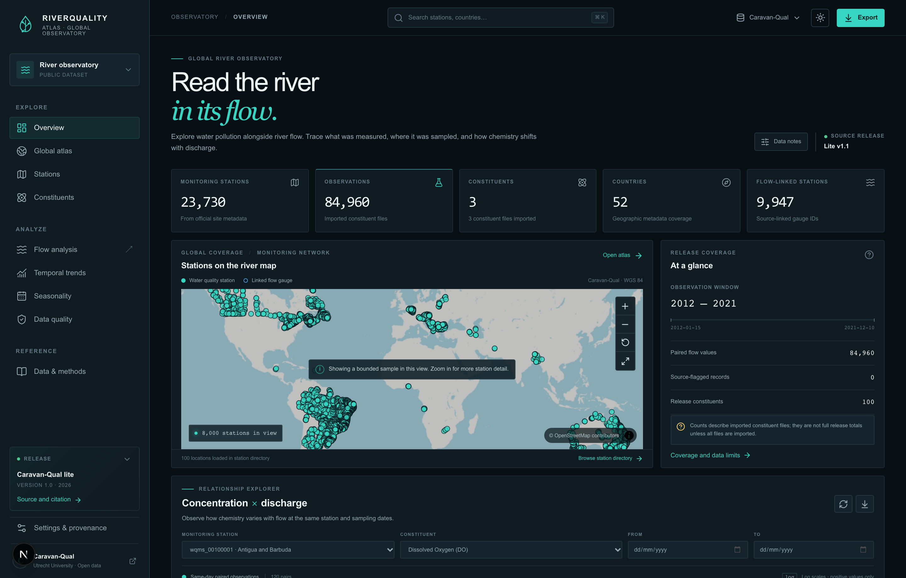
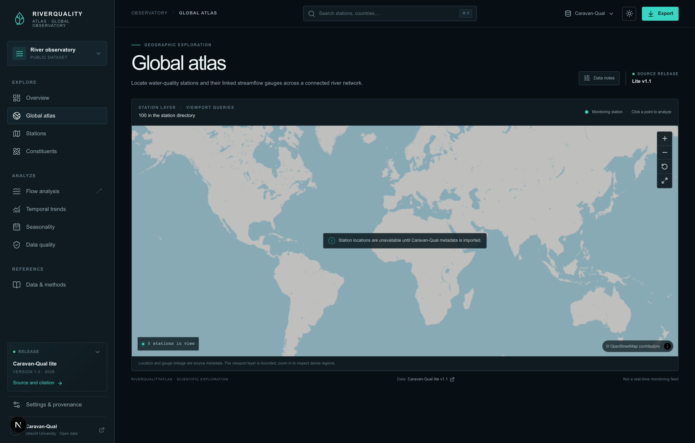
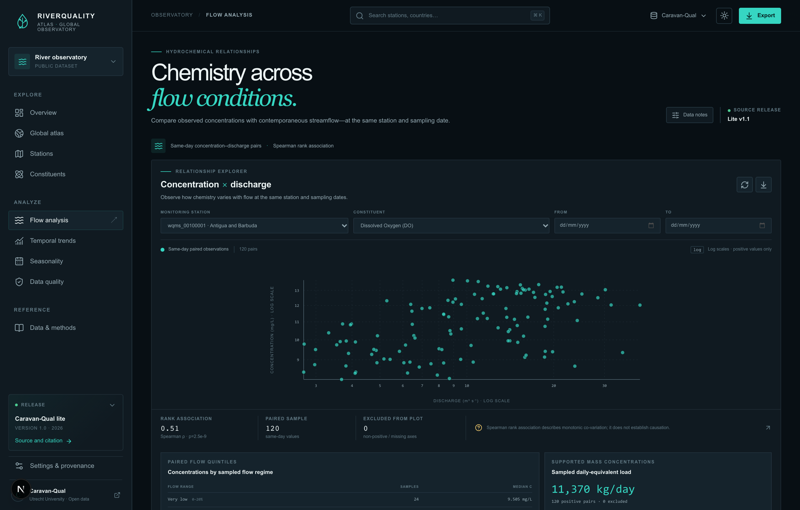
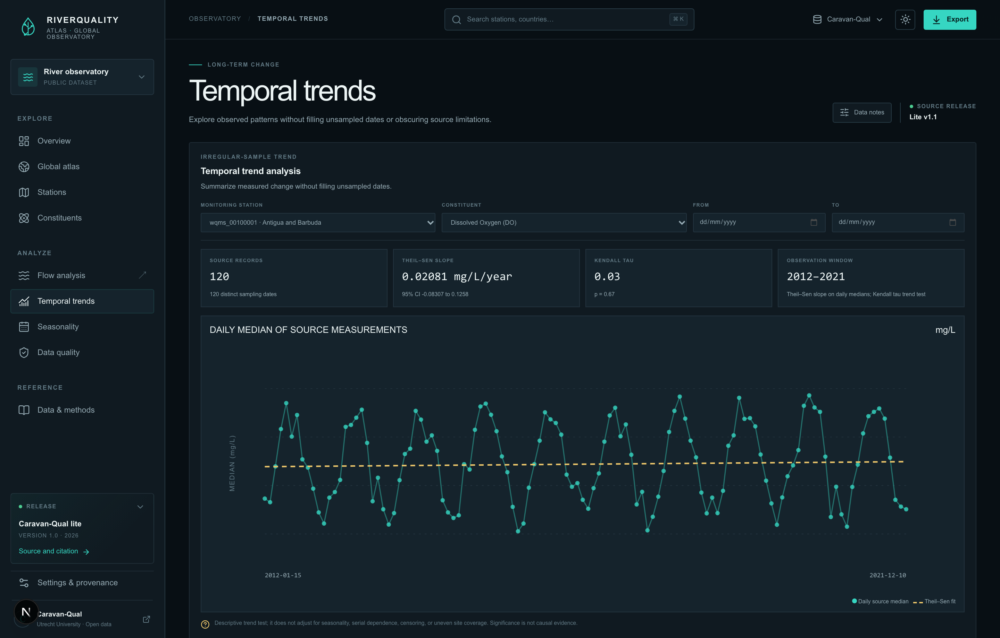
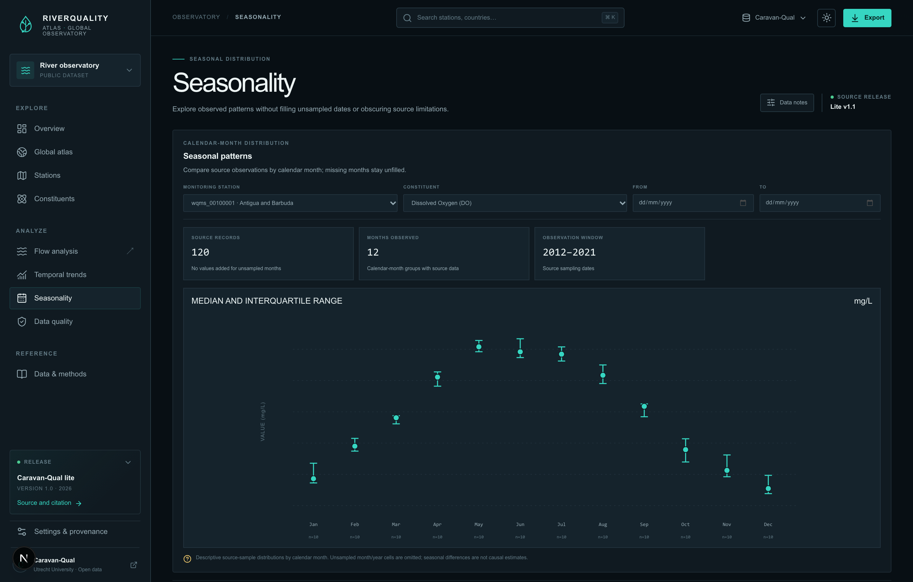
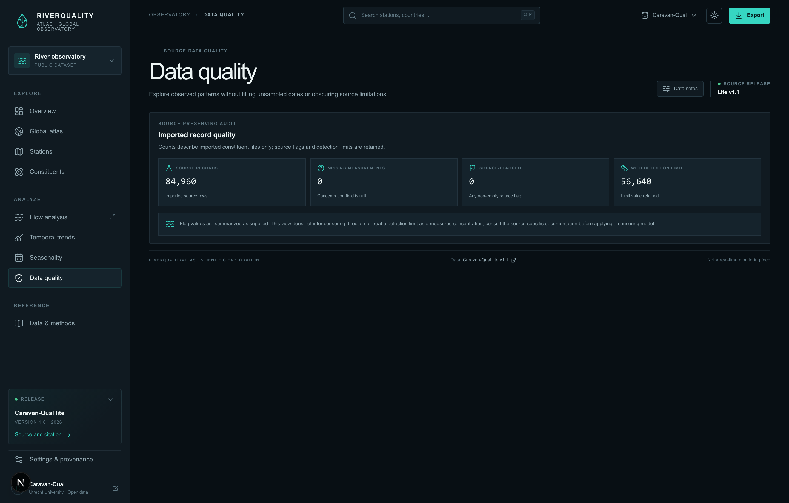
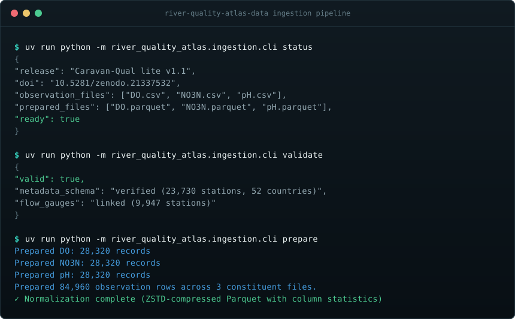

# River Quality Atlas

**Scientific exploration of water chemistry alongside river flow.**

RiverQualityAtlas is an open-source research workspace for exploring, analyzing, and visualizing the relationship between measured river water chemistry and contemporaneous streamflow. Built around the official [Caravan-Qual lite v1.1 release](https://zenodo.org/records/21337532) ([Nature Scientific Data](https://doi.org/10.1038/s41597-026-07352-7)), the platform integrates station metadata, constituent time series, river gauge linkages, and a published chemical variable registry into an interactive analytical laboratory.

[](docs/screenshots/overview.png)

---

## The Problem It Solves

Water quality cannot be understood in isolation from hydrology. A solute concentration of 10 mg/L during summer baseflow represents a fundamentally different ecological and transport regime than the same concentration during a peak flood. Yet, water quality monitoring networks and river discharge gauge networks are frequently operated by separate agencies with divergent naming conventions, sampling intervals, and data models.

Traditional approaches often resort to unscientific forward-filling, synthetic interpolation, or unverified spatial matching. **RiverQualityAtlas adheres to rigorous scientific principles**:

- **Strict Same-Date Pairing**: Concentration and streamflow observations are paired strictly on the same sampling date at the same physical station. No flow values are forward-filled or fabricated.
- **Robust Non-Parametric Statistics**: Employs Spearman's rank correlation ($\rho$), Kendall's $\tau$, and Theil–Sen median slope estimation with 95% bootstrap confidence intervals to avoid distorted outlier effects.
- **Empirical Flow Quintile Partitioning**: Breaks hydrochemical samples into sample-specific discharge quintiles (low, base, median, high, storm flow) to identify dilution versus enrichment dynamics.
- **Transparent Data Provenance**: Explicitly tracks source measurement flags, detection limits, and native units without concealing censoring directions or missing records.

---

## Visual Showcase Gallery

|                                                                                                      Global Atlas Map                                                                                                      |                                                                                                        Hydrochemical C-Q Analysis                                                                                                         |
| :------------------------------------------------------------------------------------------------------------------------------------------------------------------------------------------------------------------------: | :---------------------------------------------------------------------------------------------------------------------------------------------------------------------------------------------------------------------------------------: |
| [](docs/screenshots/atlas-map.png)<br><sub>Interactive MapLibre GL basemap with deck.gl scatterplot rendering 23,730 monitoring stations and flow gauge linkages.</sub> | [](docs/screenshots/flow-analysis.png)<br><sub>Concentration–discharge scatter with empirical power-law slopes, Kendall's rank correlation, flow quintiles, and load estimates.</sub> |

|                                                                                                         Long-Term Temporal Trends                                                                                                         |                                                                                               Seasonal Intra-Annual Cycles                                                                                                |
| :---------------------------------------------------------------------------------------------------------------------------------------------------------------------------------------------------------------------------------------: | :-----------------------------------------------------------------------------------------------------------------------------------------------------------------------------------------------------------------------: |
| [](docs/screenshots/temporal-trends.png)<br><sub>Theil–Sen robust median slope estimator, 95% confidence intervals, and daily median time series across multi-year records.</sub> | [](docs/screenshots/seasonality.png)<br><sub>Monthly median and interquartile distribution curves revealing temperature-driven and agricultural runoff seasonality.</sub> |

|                                                                                             Source Record Quality Audit                                                                                             |                                                                                          Data Ingestion CLI Pipeline                                                                                          |
| :-----------------------------------------------------------------------------------------------------------------------------------------------------------------------------------------------------------------: | :-----------------------------------------------------------------------------------------------------------------------------------------------------------------------------------------------------------: |
| [](docs/screenshots/data-quality.png)<br><sub>Flag distribution, detection limits, and metadata verification workspace ensuring analytical reproducibility.</sub> | [](docs/screenshots/cli-demo.svg)<br><sub>Command-line pipeline for downloading official Zenodo releases, validating schemas, and normalizing Parquet stores.</sub> |

---

## Key Features

- **Interactive Global Atlas**: Pan and zoom a world map powered by MapLibre GL and deck.gl. Station points are viewport-bounded, dynamically queried, and rendered with custom scatterplot layers colored by gauge link status.
- **Concentration–Discharge (C–Q) Workspace**: Log-log empirical power-law relationships ($C = a \cdot Q^b$), Spearman $\rho$, sample-specific flow quintile tables, and instantaneous daily-equivalent load calculations ($L = C \cdot Q \cdot 86.4$ kg/day for mass concentrations).
- **Theil–Sen Robust Trends**: Computes non-parametric slopes and Kendall's $\tau$ over daily-median observations, reporting exact $p$-values and 95% confidence intervals while requiring minimum sampling days.
- **Seasonality & Monthly Breakdown**: Explores intra-annual cycles with monthly boxplot distributions (median, Q1, Q3, sample counts) and year-by-year monthly breakdowns.
- **Searchable Constituent Registry**: Search 100 water-quality constituents cataloged in Caravan-Qual, review native measurement units, and verify imported availability.
- **Station Directory & Research Profiles**: Filter 23,730 stations across 52 countries by name or jurisdiction, inspect source gauge linkages, and view per-constituent sampling depth.
- **Columnar Analytical Engine**: FastAPI backend backed by DuckDB and Polars for fast SQL OLAP queries over ZSTD-compressed Parquet files.
- **Adaptive Responsive UI**: Dual dark/light theme support, accessible semantic navigation, keyboard shortcuts (`⌘K` global search), and mobile-optimized layouts.

---

## Architecture

```text
┌────────────────────────────────────────────────────────────────────────┐
│                   Next.js 16 Web Application (React 19)                 │
│  MapLibre GL + deck.gl Atlas · D3 SVG Visualizations · TanStack Query  │
└───────────────────────────────────┬────────────────────────────────────┘
                                    │ HTTP / REST
┌───────────────────────────────────▼────────────────────────────────────┐
│                    FastAPI Analytics API (Python 3.12)                 │
│         /api/v1/overview · /api/v1/stations · /api/v1/analysis         │
└───────────────────┬────────────────────────────────┬───────────────────┘
                    │                                │
┌───────────────────▼───────────┐  ┌─────────────────▼───────────────────┐
│       DuckDB Query Engine     │  │      Polars Processing Engine       │
│ Parameterized OLAP over Parquet│  │ Schema validation & Parquet sink   │
└───────────────────┬───────────┘  └─────────────────┬───────────────────┘
                    │                                │
┌───────────────────▼────────────────────────────────▼───────────────────┐
│                     Local File-Based Data Store                        │
│  data/raw/ (CSVs) ──> data/normalized/ (*.parquet) ──> data/manifests/ │
└────────────────────────────────────────────────────────────────────────┘
```

- **Frontend**: Next.js 16 (App Router), React 19, TypeScript, MapLibre GL 6, `@deck.gl/mapbox` 9, D3 7, TanStack React Query 5, Tailwind CSS 4, Lucide Icons.
- **Backend**: FastAPI, DuckDB, Polars, PyArrow, SciPy, NumPy, Pydantic, Uvicorn.
- **Data Architecture**: Flat partitioned ZSTD Parquet storage with columnar statistics; MD5-checksum provenance manifests.

---

## Installation & Quick Start

### Prerequisites

- **Node.js**: `>=22.13.0 <23`
- **pnpm**: `10.6.3`
- **Python**: `>=3.12`
- **uv**: Python package and project manager

### 1. Clone & Install Dependencies

```bash
git clone https://github.com/ranajahanzaib/river-quality-atlas.git
cd river-quality-atlas

# Install JavaScript and Python dependencies
pnpm install
uv sync
```

### 2. Start the Development Servers

Run the web frontend and analytical API concurrently:

```bash
pnpm dev
```

- Web Application: [http://localhost:3000](http://localhost:3000)
- REST API Server: [http://localhost:8000](http://localhost:8000)
- Interactive OpenAPI Docs: [http://localhost:8000/docs](http://localhost:8000/docs)

### 3. Docker Compose (Alternative)

To run the containerized stack:

```bash
docker compose up --build
```

Compose binds the web frontend to `127.0.0.1:3000` and the API to `127.0.0.1:8000`. Environment variables can be adjusted via `.env`.

---

## Official Data Ingestion

No large observational data files are stored in Git. To populate the observatory from the official [Caravan-Qual Zenodo lite release (DOI: 10.5281/zenodo.21337532)](https://zenodo.org/records/21337532):

```bash
# Quickstart: downloads official station metadata, variable dictionary,
# license archive, and dissolved oxygen (DO) records
pnpm data:quickstart

# Standard profile: dissolved oxygen (DO) and nitrate (NO3N)
pnpm data:standard

# Full profile: downloads and prepares the entire official 641 MB archive
pnpm data:full
```

### Granular CLI Data Workflow

The bundled CLI tool allows inspecting and running specific stages:

```bash
# Check status of local raw and normalized files
uv run python -m river_quality_atlas.ingestion.cli status

# Validate source metadata and schema compatibility
uv run python -m river_quality_atlas.ingestion.cli validate

# Download a specific constituent from the release archive
uv run python -m river_quality_atlas.ingestion.cli download --profile standard --constituent NO3N

# Convert CSV observations into normalized Parquet files with column statistics
uv run python -m river_quality_atlas.ingestion.cli prepare
```

Raw downloads are placed in `data/raw/` and normalized columnar Parquet files in `data/normalized/`. Provenance checksums are recorded in `data/manifests/caravan-qual.json`.

---

## Verification & Testing

Every layer of the codebase is verified through unit tests, scientific guardrail checks, static analysis, and end-to-end browser automation:

```bash
# 1. Run Python unit and analytical tests
pnpm test
# or: uv run pytest -q

# 2. Lint Python source code
uv run ruff check river_quality_atlas tests

# 3. Type-check TypeScript web application
pnpm typecheck

# 4. Lint Next.js frontend
pnpm lint

# 5. Build production Next.js bundle
pnpm build

# 6. Run Playwright end-to-end smoke tests (desktop & mobile Chromium)
pnpm test:e2e
```

---

## Development Commands Reference

| Command                                       | Purpose                                                                       |
| :-------------------------------------------- | :---------------------------------------------------------------------------- |
| `pnpm dev`                                    | Run Next.js frontend (port 3000) and FastAPI backend (port 8000) concurrently |
| `pnpm build`                                  | Compile optimized production web application with Webpack                     |
| `pnpm typecheck`                              | Validate TypeScript types across the web application (`tsc --noEmit`)         |
| `pnpm lint`                                   | Run ESLint checks across the frontend codebase                                |
| `pnpm test`                                   | Run pytest suite verifying API endpoints and analytical algorithms            |
| `uv run ruff check river_quality_atlas tests` | Run Ruff linter and code quality checks across Python source and tests        |
| `pnpm test:e2e`                               | Run Playwright end-to-end tests across desktop and mobile viewports           |
| `pnpm data:quickstart`                        | Download station metadata, variables, licenses, and dissolved oxygen          |
| `pnpm data:standard`                          | Download dissolved oxygen and nitrate observations                            |
| `pnpm data:full`                              | Download and extract complete 641 MB water-quality observation archive        |
| `pnpm data:prepare`                           | Normalize constituent CSVs to ZSTD-compressed Parquet                         |
| `pnpm data:validate`                          | Check schema completeness and metadata consistency                            |
| `pnpm data:status`                            | Inspect imported release files and dataset readiness                          |

---

## Data Licenses & Attribution

- **Caravan-Qual Dataset**: Jones et al., _Caravan-Qual: a global-scale integration of water quality observations into a large-sample hydrology dataset_, Scientific Data. Dataset DOI: [10.5281/zenodo.21337532](https://doi.org/10.5281/zenodo.21337532) (lite v1.1). Source repository: [SustainableWaterSystems/Caravan-Qual](https://github.com/SustainableWaterSystems/Caravan-Qual).
- **Dataset Terms**: The Caravan-Qual release documents CC BY 4.0 alongside 36 contributing source notes. See [docs/data-licenses.md](docs/data-licenses.md) before redistributing subsets.
- **MapLibre Worker**: Distributed under BSD-3-Clause; see [licenses/MapLibreGL.txt](licenses/MapLibreGL.txt).
- **Basemap Tiles**: © OpenStreetMap contributors.

---

## License & Custom Work

[](mailto:work@withrana.com) [](https://www.linkedin.com/in/workwithrana)
[](https://www.upwork.com/freelancers/~01bbcf6edb91a8df5f)
[](https://contra.com/ranajahanzaib/)

**License:** MIT, see [LICENSE](LICENSE). Free for personal, academic, and commercial use.

**Author:** Rana Jahanzaib

**Need this built for your stack or custom hydrology pipeline?** Email: [work@withrana.com](mailto:work@withrana.com)
